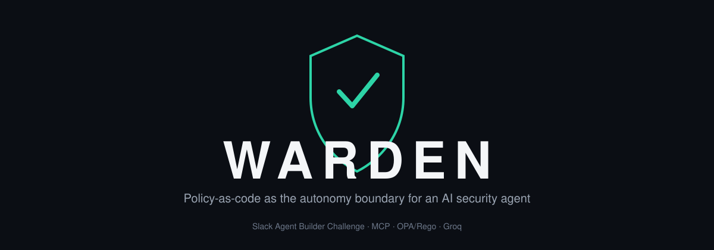

<p align="center"></p>


# Warden

Policy-as-code as the autonomy boundary for an AI security agent.

Vulnerability scanners generate more noise than any team can triage by hand — but
bolting an LLM onto the noise doesn't fix that, it just adds a new question: what is
this agent actually allowed to do on its own? Warden answers that with a
human-authored Rego policy that looks at every finding and assigns it to one of three
lanes — auto-fix, ask a human, or hard-block. The agent explains and acts, but only
inside the lane the policy already drew. It never gets to redraw the lines itself.

## How it works

1. Scan a repo (real Trivy JSON or a seeded fixture).
2. Enrich each finding with live EPSS and CISA KEV data.
3. Evaluate every finding against the OPA policy gate — `auto` / `ask` / `block`.
4. Post a color-coded digest to Slack.
5. Explain / Approve / Snooze from the message — Approve opens a real GitHub PR.

## Why this fits the challenge

- **Technological Implementation** — a custom MCP server backs every action, and a
  deterministic OPA gate decides autonomy, not the LLM.
- **Design** — a color-coded Block Kit digest with one-click Approve that opens a live
  PR, no context switching.
- **Potential Impact** — every eng org drowns in scanner noise, and the underlying
  problem (what may an agent decide alone?) generalizes far beyond CVEs.
- **Quality of Idea** — policy-as-code as agent governance, not another notification bot.

## Tech stack

- Python
- slack-bolt (Socket Mode)
- Custom MCP server (FastMCP)
- OPA / Rego
- Groq — free LLM for conversational Q&A over MCP tools
- GitHub REST API — live PR creation
- SQLite
- Docker + Render for hosting

## Project structure

```
core/         Headless brain — models, enrichment, OPA wrapper, scanner parsing, pipeline. No Slack, no MCP, no LLM.
policy/       gate.rego + gate_test.rego — the autonomy ladder itself.
mcp_server/   FastMCP server exposing core/ as four tools: scan_repo, get_findings, explain_finding, draft_fix_pr.
slack_app/    Thin Bolt Socket Mode client — Block Kit digest, button actions, Anthropic/Groq tool-use loop.
```

## Try it

```
/warden scan <owner>/<repo> --source fixture:demo_all --tests-green
```

Renders a digest with one blocked finding, one needing approval, and one already
auto-fixed.

---

Built for the Slack Agent Builder Challenge.
